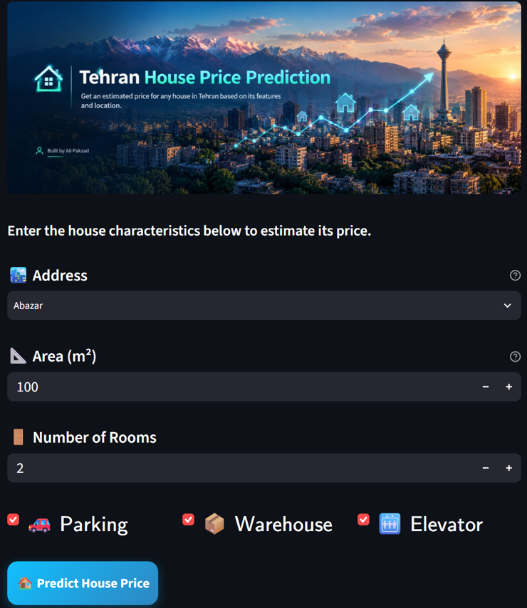

# 🏠 Tehran House Price Prediction (Contextual Outlier Detection & Regression)




## 📖 Project Overview
This project presents a complete machine learning regression pipeline designed to predict house prices in Tehran using a web-scraped dataset from Divar.ir (~3,200 listings). 

The primary challenges were handling messy real-world data (e.g., typos in addresses, string-formatted areas) and dealing with extreme outliers. Since the Tehran housing market is highly heterogeneous and naturally right-skewed, global outlier removal techniques would destroy valid luxury data. The project focuses on **Contextual Outlier Detection** and **Advanced Spatial Encoding** to build a robust predictive model, ultimately deployed as a Streamlit application.

## ⚙️ Methodology & Pipeline
1. **Data Cleaning:** Handled missing values, removed duplicate rows, converted string-formatted areas (e.g., "1,000" to `1000`), and corrected inconsistent address spellings (e.g., "Vahidieh" to "Vahidiyeh").
2. **Contextual Outlier Detection:** Instead of blindly applying global IQR (which would have discarded 319 valid luxury listings), I used neighborhood-level robust statistics (calculating median, IQR, and Robust Z-scores per address). This differentiated between genuine luxury properties and actual data-entry errors, removing only **15 anomalies**.
3. **Advanced Categorical Encoding:** The `Address` feature had 189 unique categories. I compared One-Hot Encoding with a custom **Smoothed Target Encoding** using a 5-fold Out-of-Fold (OOF) strategy. This prevented data leakage and allowed tree-based models to understand the spatial value of each neighborhood.
4. **Modeling:** Benchmarked Linear (Ridge, Lasso), Tree-based (Random Forest, Decision Tree, XGBoost), and KNN regressors.

## 🏆 Results
The use of Target Encoding and contextual data cleaning significantly outperformed the baseline, proving that handling spatial data requires domain-aware preprocessing.

| Model | Encoding Method | Test R² Score | Test RMSE |
| :--- | :--- | :--- | :--- |
| Linear Regression | One-Hot Encoding | 51.5% | 6.12B |
| XGBoost | Target Encoding | 70.4% | 4.78B |
| **Decision Tree (Winner)**| **Target Encoding** | **74.17%** | **4.47B** |

## 💡 Key Insights
* **Outliers vs. Errors:** In real estate, a high price or large area is not necessarily an error; it often reflects a luxury neighborhood (e.g., Elahieh, Zaferanieh). By using localized statistical bounds, we preserved valuable data while removing noise.
* **Target Encoding for High Cardinality:** Target encoding proved vastly superior to One-Hot Encoding for high-cardinality spatial features, boosting the R² score of tree-based models by over 20%.
* **The Spatial Premium:** Feature importance showed that location (Address) is the absolute dominant factor in Tehran's housing market, far outweighing physical features like area or number of rooms.

## 📂 Repository Structure
```text
├── notebooks/
│   └── tehran-house-price-prediction.ipynb    # Main Jupyter Notebook
├── app/
│   └── app.py                                 # Streamlit Web Application source code
├── requirements.txt                           # Python dependencies
└── README.md                                  # Project documentation
```

---

## 🚀 How to Run

1. Clone the repository:
   git clone https://github.com/AliPakzad/Tehran-House-Price-Prediction.git

2. Install the required packages:
   pip install -r requirements.txt

3. To run the Jupyter Notebook:
   jupyter notebook notebooks/tehran-house-price-prediction.ipynb

4. To run the Streamlit Web App locally:
   streamlit run app/app.py

## 🔗 Links
* **Live Streamlit App:** https://alipakzad-tehran-house-price-prediction.streamlit.app/
* **Kaggle Notebook:** https://www.kaggle.com/code/alipakzad/tehran-house-price-prediction-xgboost-rf-dt
* **LinkedIn:** https://www.linkedin.com/in/ali-pakzad-b145a3b4
* **GitHub Profile:** https://github.com/AliPakzad

---
**Author:** Ali Pakzad (Data Scientist & ML Engineer)
