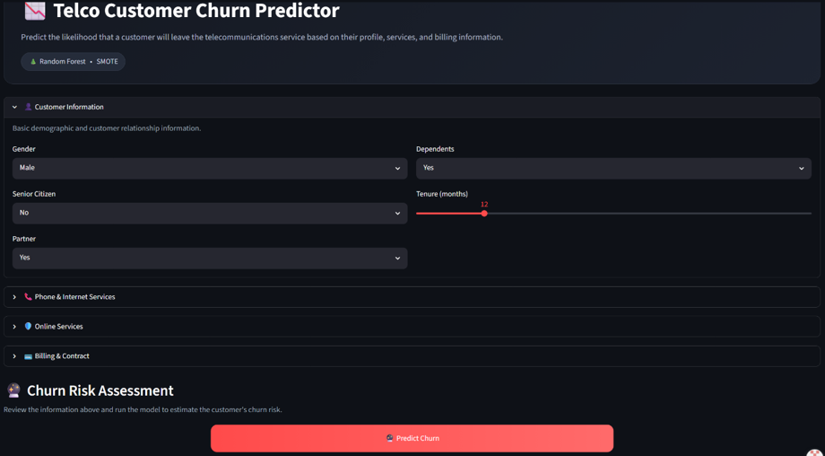
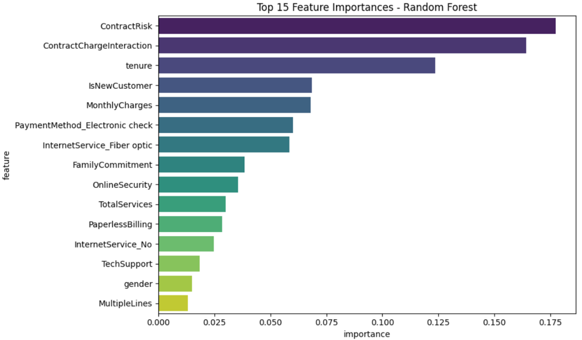

# 🏢 Telco Customer Churn Prediction (End-to-End ML)


## 📖 Project Overview
This project presents a complete end-to-end Machine Learning pipeline and a deployed web application designed to predict customer churn for a telecommunications company. 

With acquiring a new customer costing 5-7 times more than retaining an existing one, the primary goal was to identify high-risk customers and uncover actionable business insights to improve retention strategies. The dataset contains 7,043 customers with a baseline churn rate of ~27%.

## ⚙️ Methodology & Pipeline
1. **Custom Feature Engineering:** Engineered domain-specific features using a custom Scikit-Learn transformer (e.g., `ContractRisk`, `IsNewCustomer`, and `ContractChargeInteraction`) to capture the behavioral profile of churners.
2. **Robust ML Pipeline:** Built a fully reproducible pipeline combining feature engineering, One-Hot Encoding, and Standard Scaling using `ColumnTransformer`.
3. **Imbalance Handling:** Benchmarked 5 classifiers (Logistic Regression, Random Forest, XGBoost, LightGBM, SVM) across 3 strategies: Baseline, Class Weight, and **SMOTE**.
4. **Ensemble Modeling:** Built a **Stacking Ensemble** (combining Random Forest, LightGBM, and SVM) with a Logistic Regression meta-learner, followed by **Threshold Tuning** to maximize the F1-score.

## 🏆 Results
The final stacked model achieved a 3% performance boost over the baseline, significantly improving the detection of potential churners.

| Model Configuration | F1-Score (Churn) | ROC-AUC |
| :--- | :--- | :--- |
| Baseline LightGBM | 0.587 | 0.829 |
| Random Forest + SMOTE | 0.621 | 0.826 |
| **Stacking + Threshold (0.40) (Winner)**| **0.627** | **0.827** |

## 💡 Key Insights
* **Contract Type is King:** "Month-to-month" contracts combined with high monthly charges create the highest risk profile. Customers on two-year contracts churn at a rate of only ~3%, compared to ~43% for month-to-month.
* **First Year is Critical:** New customers (tenure ≤ 12 months) are at the highest risk.
* **Value-Added Services Reduce Churn:** Offering services like OnlineSecurity or TechSupport drastically reduces churn by increasing customer stickiness.
* **Deployment:** The final optimized model was successfully deployed as an interactive Streamlit application for real-time prediction.

## 📊 Visualizations

 
 

## 📂 Repository Structure
```text
├── notebooks/
│   └── telco-churn-prediction.ipynb    # Main Jupyter Notebook (EDA, Pipelines, Stacking)
├── app/
│   └── app.py                          # Streamlit Web Application source code
├── requirements.txt                    # Python dependencies
└── README.md                           # Project documentation
```

## 🚀 How to Run

1. Clone the repository:
   git clone https://github.com/AliPakzad/Telco-Customer-Churn-Prediction.git

2. Install the required packages:
   pip install -r requirements.txt

3. To run the Jupyter Notebook:
   jupyter notebook notebooks/telco-churn-prediction.ipynb

4. To run the Streamlit Web App locally:
   streamlit run app/app.py

## 🔗 Links
* **Live Streamlit App:** https://alipakzad-telecom-customer-churn.streamlit.app/
* **Kaggle Notebook:** https://www.kaggle.com/code/alipakzad/telecom-churn-prediction-eda-random-forest
* **LinkedIn:** https://www.linkedin.com/in/ali-pakzad-b145a3b4
* **GitHub Profile:** https://github.com/AliPakzad

---
**Author:** Ali Pakzad (Data Scientist & ML Engineer)
